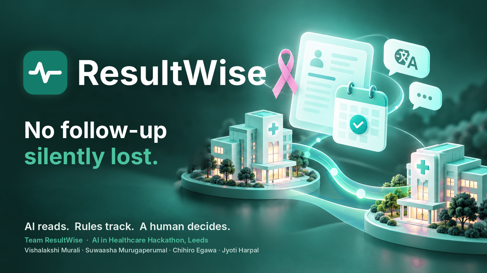
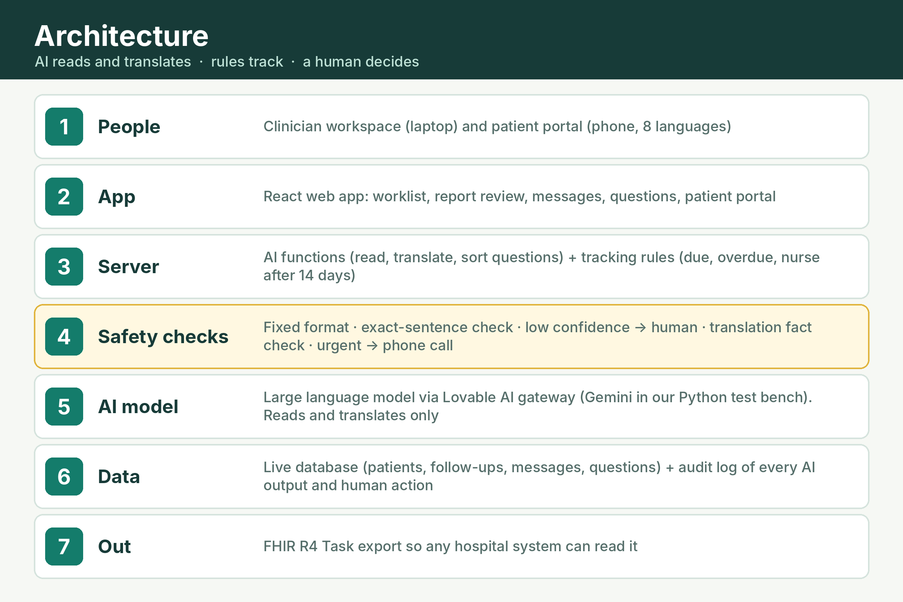
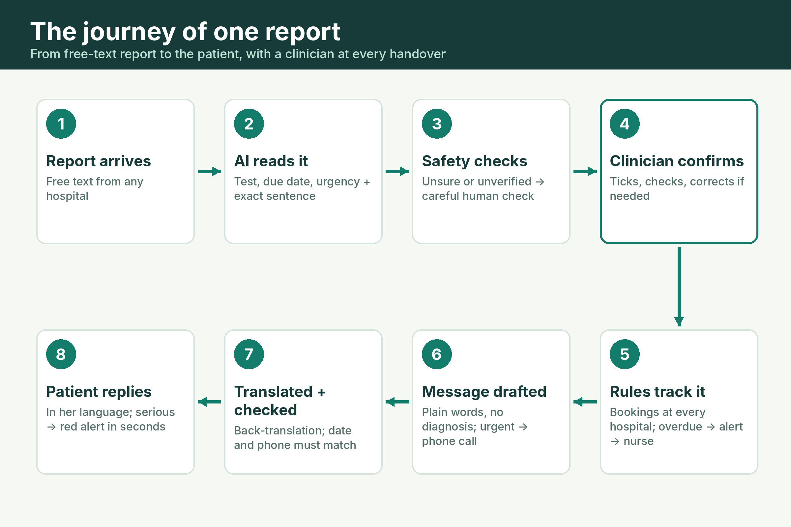
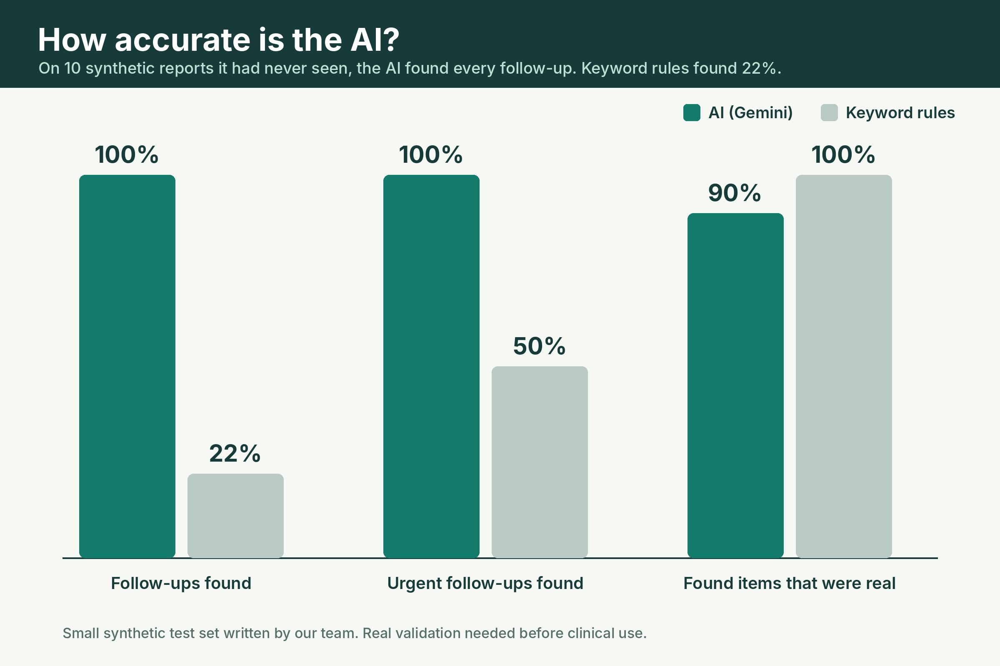

# ResultWise



**Team ResultWise:** Vishalakshi Murali · Suwaasha Murugaperumal · Chihiro Egawa · Jyoti Harpal
(AI in Healthcare Hackathon, Leeds)

**No follow-up silently lost.** ResultWise reads breast cancer scan reports with AI, tracks every recommended
follow-up across hospitals, and reaches the patient in her own language, with a clinician approving every step.

> **All data is synthetic.** Fictional hospitals and patients, NHS numbers from the 999 test range, phone numbers
> from Ofcom's drama ranges. Hackathon prototype: not a medical device, not clinically validated.

## The problem

A scan report ends with a line like *"repeat echocardiogram in 12 weeks"*. Someone has to read it, book it and
tell the patient. When care moves between hospitals, each system only sees its own bookings, so the follow-up
falls through the gap. Breast cancer patients are especially exposed: years of heart scans, bone density scans
and mammograms, often at different hospitals.

## How it works

**AI reads and translates. Rules track. A human decides.**

1. **AI reads the report** and pulls out the test, due date, urgency and the exact sentence it came from.
2. **A clinician checks and confirms** before anything is tracked.
3. **Rules track it at every hospital**: reminder when due, alert when overdue, nurse after 14 days.
4. **The patient gets a message in her language**, translated, back-translated, fact-checked and approved by a
   clinician. Urgent findings always get a phone call instead.
5. **The patient can reply or ask a question**, and serious ones reach the clinician in seconds.





Each layer is explained in [`docs/ARCHITECTURE.md`](docs/ARCHITECTURE.md).

## Synthetic data

No real patient data was used, not even anonymised. Everything was generated by
[`data/generate_data.py`](data/generate_data.py) with a fixed seed. Full details and a data dictionary are in
[`data/README.md`](data/README.md).

| File | What it is |
|---|---|
| [`reports.json`](data/reports.json) | 104 NHS-style breast cancer scan reports with correct answers attached |
| [`heldout_reports.json`](data/heldout_reports.json) | 10 held-out reports, never used for tuning (the fair test) |
| [`patients.csv`](data/patients.csv) | 60 patients: age, language, contact method, deprivation, home hospital |
| [`bookings.csv`](data/bookings.csv) | Bookings across two fictional hospitals, some deliberately missing |
| [`history.csv`](data/history.csv) | 900 past follow-ups, with known inequalities built in to test the equity view |
| [`lovable_demo/demo_cases.json`](data/lovable_demo/demo_cases.json) | The web app's 9 patients and 10 cases, plus pre-written translations |
| [`sample_reports/`](data/sample_reports/) | 3 sample reports as .txt / .pdf / .docx to try the upload |

Fictional hospitals (Northbridge, Valeford), invented people, NHS numbers from the 999 test range, phone numbers
from Ofcom's drama ranges.

## What's in this repo

The main product is the **web app**, built with Lovable (React + Lovable Cloud). This repo holds the
**Python test bench** where we built and measured the AI, plus the data and docs.

| | |
|---|---|
| Architecture | [`docs/ARCHITECTURE.md`](docs/ARCHITECTURE.md) |
| Synthetic data and data dictionary | [`data/README.md`](data/README.md) |
| Problem statement and evidence | [`PROBLEM_STATEMENT.md`](PROBLEM_STATEMENT.md) |
| Python test bench | [`app.py`](app.py), [`resultwise/`](resultwise/), [`eval.py`](eval.py), [`tests/`](tests/) |
| Devpost story | [`DEVPOST.md`](DEVPOST.md) |

## Evaluation

Tested on **10 held-out reports** written after the rules were built and never used to tune them.

| | AI (Gemini) | Keyword rules |
|---|---|---|
| Follow-ups found | **100%** | 22% |
| Found items that were real | 90% | 100% |
| Urgent follow-ups found | **100%** | 50% |
| Timeframe correct | 100% | 100% |
| Urgency correct | 89% | 100% |



The rules score 97% on the 104 reports we tuned them on, but only 22% on new wording. That's why the AI reads the
reports and the rules are only the fallback. Small synthetic test set; real validation would be needed before
clinical use.

## Run it

```bash
pip install -r requirements.txt
streamlit run app.py
```

Works offline with the rules. To turn on the AI, set one key: `GEMINI_API_KEY` or `GROQ_API_KEY` (both have free
tiers), or `ANTHROPIC_API_KEY` / `OPENAI_API_KEY`. Only synthetic text is ever sent.

```bash
pytest -q                          # 33 tests, also run on every push
python eval.py --engine offline    # or --engine gemini
python data/generate_data.py       # regenerate the synthetic data
```

## Run a local model (step 2 of 1 → 2 → FREE)

Test a free, open-source model running **on your own computer**, so no text leaves the machine. It uses the same
extraction code and the same 10 held-out reports, and prints its score next to Gemini and the keyword rules. The app
itself is not changed.

1. Install [Ollama](https://ollama.com/download) and open it.
2. Download a model in a terminal: `ollama pull qwen2.5:7b` (about 4.7 GB) or, for a lighter laptop,
   `ollama pull llama3.2:3b` (about 2 GB).
3. In this folder:

```bash
pip install pydantic
python local_model_eval.py                       # or: --model llama3.2:3b
```

Results are saved to `local_eval_results.json`.

## Limits

- Synthetic data only, and a small held-out test set.
- Bookings are simulated; a real system would read them from each hospital via FHIR / HL7.
- Translations need native-speaker review before real use.
- Going live would need a DPIA, Caldicott approval, data-sharing agreements, a clinical safety case
  (DCB0129/0160) and validation on real reports.
