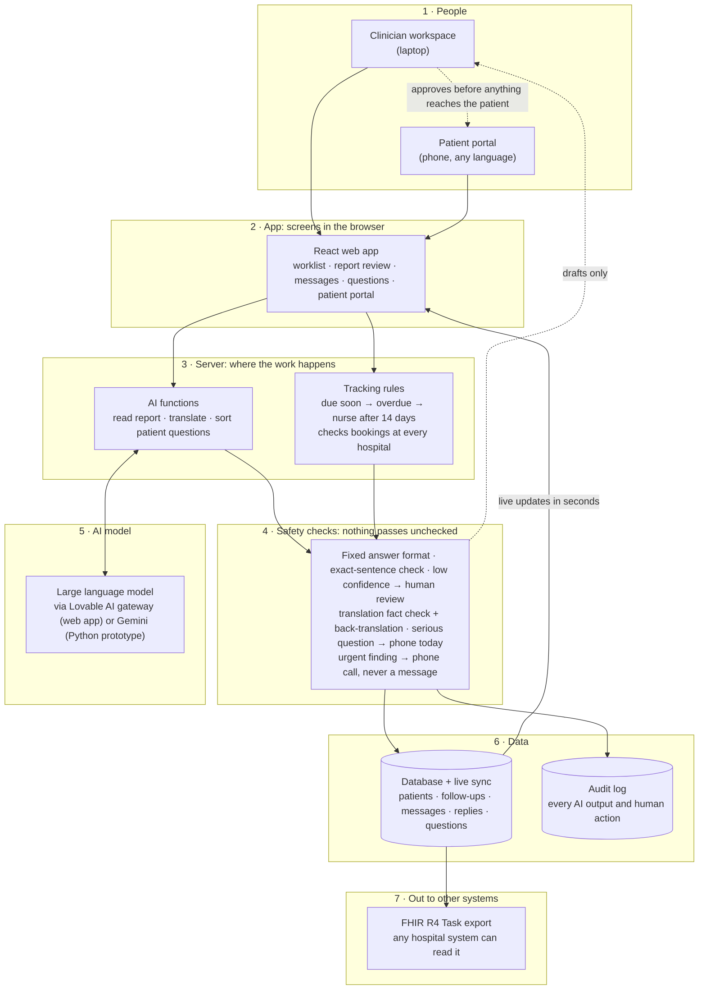
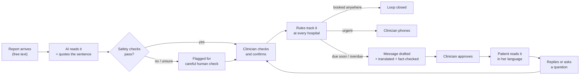

# Architecture

Resultwise in one sentence: **AI reads and translates, plain rules track, a human decides.**

## The big picture

(Same diagram as an image: [`architecture.png`](architecture.png). Journey of one report: [`report-journey.png`](report-journey.png).)

## Each layer in plain words

| # | Layer | What it does | Built with |
|---|---|---|---|
| 1 | **People** | Two users. The **clinician** reviews and approves. The **patient** reads messages in her language and can reply or ask a question. | |
| 2 | **App** | The screens. Works on phone, tablet and laptop. Accessibility: 8 languages incl. right-to-left, easy read, large text, high contrast, read aloud. | React, TanStack Start, Tailwind, shadcn/ui, Web Speech API |
| 3 | **Server** | **AI functions** read a report into a follow-up (test, due date, urgency, evidence sentence, confidence), translate messages, and sort patient questions. **Tracking rules** are plain code, not AI: they check every hospital for a booking, flag overdue, and escalate to a nurse after 14 days. | TanStack Start server functions, TypeScript |
| 4 | **Safety checks** | Every AI answer must fit a fixed format. The evidence sentence must really be in the report. Low confidence goes to a human. Translations are back-translated and the date, phone number and name must survive exactly. Serious patient questions (or any AI failure) are flagged for a phone call today. Urgent findings never get an automated message. | Zod schemas, rule code, automated tests |
| 5 | **AI model** | A general large language model, used only for reading and translating. It never decides, books or sends anything. | Lovable AI gateway (OpenAI model); Google Gemini in the Python prototype |
| 6 | **Data** | Stores patients, follow-ups, messages, replies and questions, and pushes changes live, so a patient's reply appears on the clinician's screen within seconds. The audit log records every AI output and every human decision. | Lovable Cloud (Supabase Postgres + Realtime) |
| 7 | **Out** | Each confirmed follow-up can be exported as a **FHIR R4 Task**, the NHS-standard format, so another hospital's system could pick it up. | FHIR R4 |

## The journey of one report

## Two codebases, one idea

| | Web app (the product) | Python prototype (the test bench) |
|---|---|---|
| Purpose | What clinicians and patients use | Where we built and **measured** the AI |
| Stack | Lovable: React + TanStack Start + Lovable Cloud + Lovable AI gateway | Python, Streamlit, Pydantic, SQLite, Gemini / Claude / OpenAI / Groq |
| Data | `data/lovable_demo/demo_cases.json` | `data/reports.json`, `heldout_reports.json`, `patients.csv`, `bookings.csv`, `history.csv` |
| Tests | 60+ automated tests | 33 automated tests + `eval.py` + GitHub Actions |

This follows the **1 → 2 → FREE** approach: use a powerful model to explore what's possible (step 1), compare
it against a simple, transparent, free baseline (step 2: our keyword rules), and **freeze** the result behind a
test harness, fixed answer formats and version control so it can be safety-checked (FREE(ZE)). Next step: replace
the cloud model with a small open-source model running locally, benchmarked on the same evaluation set.

## What it would take to go live

Read real orders and bookings from each hospital's record system (FHIR / HL7), UK-hosted infrastructure, a
contract with the AI provider (or a local model), a data protection impact assessment, Caldicott approval,
data-sharing agreements between trusts, clinical safety cases (DCB0129 / DCB0160), professional translation, and
validation on real reports.
